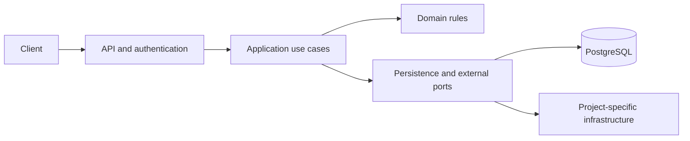

# MarketMesh — Backend Developer Track

**Project 6 of 8 · Independent capstone · requirements only; choose compatible supported dependencies**

> Start with [Getting Started](docs/GETTING_STARTED.md), then [Submission Rules](docs/SUBMISSION_RULES.md). The complete rules are below; milestone checklists point back here.

## 1. Overview

Build **MarketMesh**, a backend for **marketplace orders across independent services**. You implement the application, data model, API and failure handling. The learning focus is: Architecture from scratch: service boundaries, gRPC/Protobuf, REST, Kafka, sagas, money, distributed idempotency, contract evolution, resilience, OpenTelemetry.

This is original learning material organized like the supplied `substream.zip`: numbered specification, stable business-rule IDs, M1–M3 shared milestones, D4–D7 developer milestones, an AQA guide and reflection. It is not connected to the SubStream/NIX grading bot. The reference project is [SubStream](https://github.com/Abd-Elrahman3/SubStream-Developer-Track); no completed solutions or proprietary bot are included.

## 2. How the Challenge Works

### 2.1 Milestones

Do projects in order. Prerequisite: complete D7 of [FleetStream](https://github.com/Abd-Elrahman3/fleetstream-spring-boot) and explain its failure drills.
Every milestone is required. Advanced requirements are part of completion, not optional stretch goals. M1–M3 establish the model, database and transactions; D4–D7 add contracts, difficult behavior, failure recovery and operation.

| Milestone | Goal | Branch | Guide |
| --- | --- | --- | --- |
| M1 | Domain and invariants | `feature/m1-domain` | [Shared](docs/SHARED_MILESTONES.md) |
| M2 | Database and persistence | `feature/m2-database` | [Shared](docs/SHARED_MILESTONES.md) |
| M3 | Transactional use cases | `feature/m3-transactions` | [Shared](docs/SHARED_MILESTONES.md) |
| D4 | API contracts and authorization | `feature/d4-api` | [Developer](docs/TRACK_DEVELOPER.md) |
| D5 | Advanced behavior and resource limits | `feature/d5-advanced` | [Developer](docs/TRACK_DEVELOPER.md) |
| D6 | Failure testing and recovery | `feature/d6-failures` | [Developer](docs/TRACK_DEVELOPER.md) |
| D7 | Operations and design defense | `feature/d7-operations` | [Developer](docs/TRACK_DEVELOPER.md) |

### 2.2 Levels

Bronze = M2; Silver = D4; Gold = D6; Platinum = D7 **with evidence**. Complete Platinum before progressing to the next project. A blocked feature should get a smaller reproducible experiment; do not mark it complete by removing its assertion.

### 2.3 How your work is evaluated

This repository intentionally contains only Markdown. You must create the build, implementation, tests and CI yourself. The acceptance specification and evidence checklist define completion; there is no preinstalled grader.

Automation is a guardrail, not proof of understanding. You own these repositories and can bypass local checks; keep the gates intact, review tests and explain tradeoffs aloud. There is no hidden evaluator and branch protection is not configured by these files.

## 3. Architecture



The API binds and validates transport input. The service establishes authorization and transaction boundaries. Domain objects enforce state rules. Persistence adapters map database data without leaking entities to API responses. Dependencies and clocks are constructor-injected. Keep network calls outside long database transactions and record uncertain outcomes explicitly.

See [Database Requirements](docs/DATABASE_REQUIREMENTS.md), [API Requirements](docs/API_REQUIREMENTS.md) and [Architecture Decisions](docs/ARCHITECTURE_DECISIONS.md) for this project's concrete boundaries.

### 3.1 How the classes relate

| Area | Responsibility |
| --- | --- |
| domain | Order, Reservation, PaymentAuthorization, SagaStep |
| service | Use cases, transaction boundary and principal-derived identity |
| repository / persistence | Ports, SQL/JPA/R2DBC mappings, constraints and query strategy |
| api | DTOs, controllers/resolvers, validation and error mapping |
| advanced | Required project-specific workers, policies and adapters |
| config | Dependency injection, Clock, security, typed configuration |

## 4. Domain Model

| Type | Fields / types | Invariant |
| --- | --- | --- |
| Order | UUID id; String buyerSubject; List<OrderLine> lines; Money total; OrderStatus status | PENDING → CONFIRMED or COMPENSATING → CANCELLED; fulfillment only after confirmation. |
| Reservation | UUID id; UUID orderId; UUID skuId; int quantity; Instant expiresAt | Inventory service owns inventory and reservation tables. |
| PaymentAuthorization | UUID id; UUID orderId; Money amount; String providerKey; String status | Payment service owns payment state; no card data is stored. |
| SagaStep | UUID sagaId; String step; String state; int attempt; Instant deadline | Durable workflow state; every transition deduplicated. |

Fields are private. Do not add public state setters to bypass business methods. A rejected domain operation changes nothing. IDs are UUIDs unless explicitly stated otherwise. Identity equality uses persistent ID; value objects use their values. Store timestamps as UTC `Instant`; use `LocalDate` only for calendar-date rules. Nullability is explicit in database/API specs; unknown IDs are never treated as empty success. Use `ConflictException` for invalid state transitions and `IllegalArgumentException` for invalid domain values. Constructor signatures in starter examples are stable; you may add overloads, private fields and new classes as requirements grow.

No classes are supplied. Translate this model into code after documenting invariants and storage ownership; justify changes in an ADR.

## 5. Business Rules

Rule IDs are local to this repository. Each rule includes a concrete acceptance example. Full behavior, boundaries and failures matter; the examples are a starting test set.

### M1 — Domain and invariants

#### BR-101 — Specify money and orders

Use Money(BigDecimal amount,String currency), exactly two decimal places for USD/EUR in this exercise. Reject negative prices, quantities outside 1..100 and mixed-currency orders. Freeze price snapshots at order creation.

**Acceptance example:** Two units at 19.95 plus one at 10.00 → 49.90; later catalog changes do not alter the order.

#### BR-102 — Draw service ownership

Implement separately deployable order,inventory,payment services. Each owns its PostgreSQL database/schema and credentials. No shared-table joins or cross-service entity imports. Define which read models may be eventually consistent.

**Acceptance example:** Turning off payments does not prevent catalog reads; an architecture test rejects imports of another service’s persistence package.


### M2 — Database and persistence

#### BR-201 — Conserve inventory

Inventory reservation is atomic and idempotent by orderId+skuId; available never negative. Reserve,confirm,release and expiry use row locks/constraints. Release is idempotent and never increments twice.

**Acceptance example:** 100 requests for stock 10 confirm at most 10 units; duplicate release changes available stock once.

#### BR-202 — Separate local transactions

Every service has versioned migrations, inbox/outbox and local atomic effects. No distributed DB transaction. Document consistency points and reconciliation queries for each service.

**Acceptance example:** A local rollback leaves neither business effects nor an outgoing event; cross-service lag is visible in order status.


### M3 — Transactional use cases

#### BR-301 — Design gRPC inventory contracts

Write protobuf package market.inventory.v1 with Reserve,Confirm,Release,GetReservation. Use string UUIDs and integer minor units where needed; reserve deleted field numbers. Propagate a 2s total deadline and correlation metadata. Use TLS/mTLS between services in the final deployment.

**Acceptance example:** Client cancellation stops unnecessary work; deadline timeout is treated as uncertain, then queried by stable reservation key.

#### BR-302 — Make retry behavior explicit

gRPC UNAVAILABLE/DEADLINE_EXCEEDED may retry only idempotent operations within remaining deadline; INVALID_ARGUMENT/FAILED_PRECONDITION do not retry. Max 3 attempts with jitter; retry budget per service prevents amplification.

**Acceptance example:** Three nested retries cannot turn one order into 27 provider requests; demonstrate attempt counters during an outage.


### D4 — API contracts and authorization

#### BR-401 — Orchestrate the saga

Order orchestrator requests inventory, authorizes payment, confirms inventory, then confirms order. Failures enter compensating state and release inventory/void authorization. Durable state resumes after restart. A timeout is UNKNOWN until reconciled.

**Acceptance example:** Restart at every boundary; the order ends CONFIRMED or CANCELLED with no leaked stock/payment authorization.

#### BR-402 — Handle late and duplicate results

Events carry eventId,orderId,version,correlationId. Dedup within each consumer transaction. A payment success arriving after cancellation triggers void/refund workflow, never resurrects the order.

**Acceptance example:** Deliver success twice and after cancellation: one compensation effect, terminal order remains cancelled.


### D5 — Advanced behavior and resource limits

#### BR-501 — Expose secure REST and order events

Buyer JWT owns orders; support Idempotency-Key for creation and cursor pagination. GET order exposes PENDING with links until settled. SSE publishes state changes with resumable IDs. Operations endpoints need separate scope.

**Acceptance example:** Another buyer gets 404; same creation key+payload returns same order; changed payload gets 409.

#### BR-502 — Version events and contracts

Kafka topics market.orders.v1 and market.payments.v1 use Protobuf/JSON schema contracts. Preserve compatibility and upcast stored old events. Run consumer contracts in CI before producer releases.

**Acceptance example:** Deploy old consumer with new optional field; process successfully. A removed required field is blocked by compatibility tests.


### D6 — Failure testing and recovery

#### BR-601 — Reconcile discrepancies

Scheduled reconciliation finds orders stuck >5m, inventory reservations without live saga and unknown payment outcomes. Repair is idempotent, audited and bounded; never repair by silently writing another service’s DB.

**Acceptance example:** Seed 20 inconsistent scenarios; reconciliation resolves each through service contracts or marks manual action with reason.

#### BR-602 — Test systemic failure

Use Testcontainers, provider mocks and process kill/network delay drills. Validate no oversell, no duplicate capture and eventual compensation under retries, duplicate/out-of-order delivery and partitions.

**Acceptance example:** A 2-minute payment outage drains after recovery; all accepted orders are accounted for in a reconciliation report.


### D7 — Operations and design defense

#### BR-701 — Define SLOs and deploy safely

Target 99.9% order-intake availability and 99% settlement within 30s when providers healthy. Define error budget, burn-rate alerts, resource requests, graceful shutdown and rolling deployment with old/new contracts.

**Acceptance example:** Load at 50 orders/s for 10m, report p50/p95/p99 and settlement lag; show zero lost accepted orders during rollout.

#### BR-702 — Defend the design

Provide threat model, service boundary ADRs, compensation table, event catalog, capacity estimate, backup/restore and on-call runbooks. Explain where exactly-once is impossible and which effects are effectively once.

**Acceptance example:** A reviewer can trace every accepted order to a terminal state or explicit recovery record without guessing.

## 6. Provided Infrastructure

Provided: this specification, milestone guides, API/database requirements, acceptance scenarios, operations exercises, primer reading guidance and reflection. No Java, SQL, build files, containers or CI are supplied.

External providers must be mocked locally. No real payments, messages to customers or paid cloud accounts are needed. Install only the components required for the current milestone. See setup instructions for versions and ports.

## 7. Project Structure

```text
README.md                     full model and business rules
REFLECTION.md                 evidence of understanding
docs/GETTING_STARTED.md        setup and first milestone
docs/SHARED_MILESTONES.md       M1–M3 checklists
docs/TRACK_DEVELOPER.md         D4–D7 checklists
docs/TRACK_AQA.md               mandatory complementary testing track
docs/SUBMISSION_RULES.md        branches, commits, completion rules
docs/DATABASE_REQUIREMENTS.md  schema, constraints, indexes, migrations
docs/API_REQUIREMENTS.md       transport, status, auth and payload rules
docs/ACCEPTANCE_TESTS.md        failure and boundary test matrix
docs/ADVANCED_BACKEND_GATES.md  non-optional completion evidence
docs/LEARNING_PATH.md           eight-project progression
docs/primers/                  short concept guides and official references
docs/aqa/                      API test guidance
docs/evidence/                 fill after reproducing each milestone

```

## 8. What Good Code Looks Like Here

Use clear transaction boundaries, immutable DTOs, constructor injection and small use cases. Never depend on H2 to prove PostgreSQL locking/constraints. Never log credentials. Tests assert durable state and externally observable behavior, not only mocked call counts. Keep request/broker buffers bounded and retries limited. Explain every index, retry and trust boundary you introduce. Record actual measurements instead of assuming a technology is faster.

This curriculum covers a broad backend progression; it does not claim to exhaust every Spring module. [Learning Path](docs/LEARNING_PATH.md) maps the concepts and identifies follow-on subjects.

See [Implementation Labs and Contract Details](docs/IMPLEMENTATION_LABS.md) for concrete fixtures, payload semantics and boundary experiments. These are required, not optional extras.
